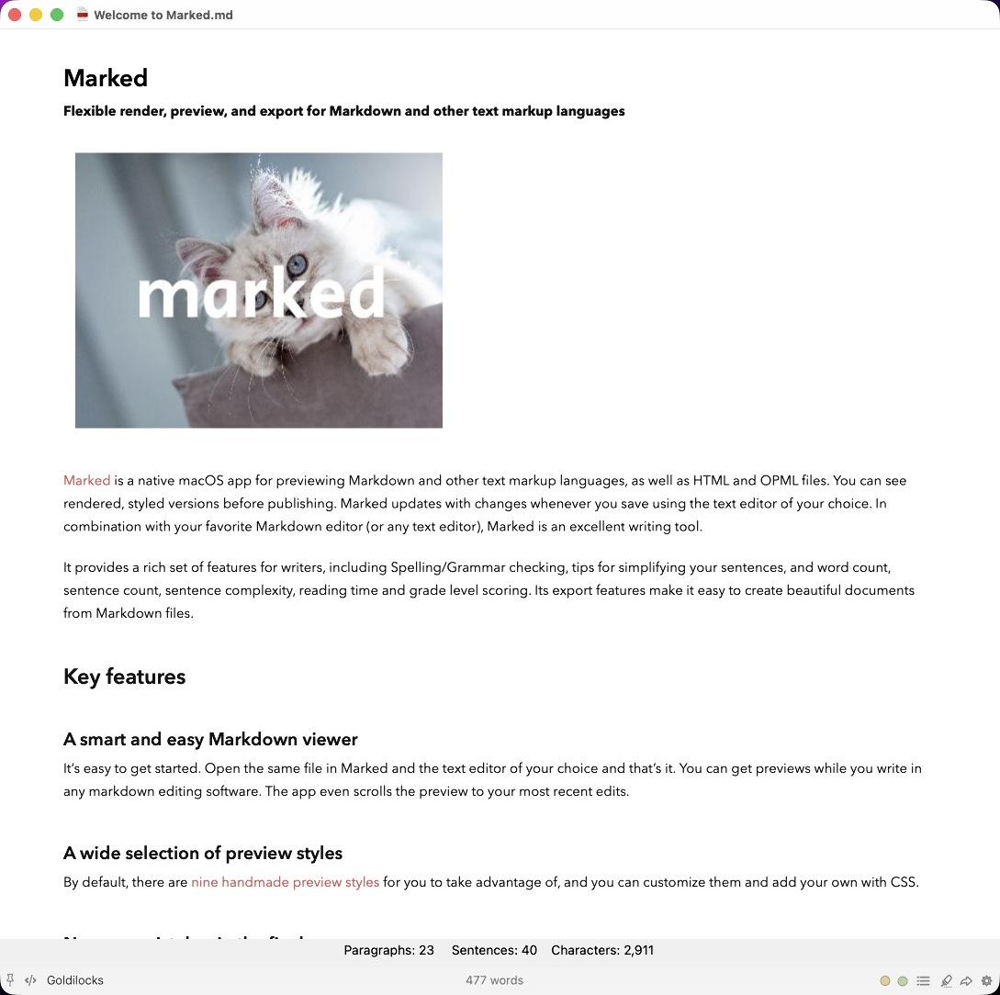

# <%= @title %>

By opening , Marked receives live updates over a named pasteboard instead of watching a file on disk. The source app must integrate with Marked.

[Curio](Curio.html), [Drafts](Drafts.html), [The Archive](The_Archive.html), and [Traverse](Traverse.html) document their own toggles and menu commands. nvUltra, nvALT, Bear, and others use the same channel: open streaming preview in Marked, enable integration in your editor, and start typing; updates arrive in near real time.

## Developers [developers]

To integrate the Streaming Preview with your app, you just need to put the markdown text to preview on a named clipboard. Use the following code (Objective-C) to update, preferably on a didEndEditing method or at throttled intervals:

```obj-c
NSString *rawString = @"the text to process";
// pasteboard *must* be named 'mkStreamingPreview'
NSPasteboard* pb = [NSPasteboard pasteboardWithName:@"mkStreamingPreview"];
[pb clearContents];
[pb setString:rawString forType:(NSString*)kUTTypeUTF8PlainText];
```

### Declaring a Base URL for relative assets [declaring-a-base-url-for-relative-assets]

You can also provide a base url for the streaming preview, allowing relative URLs in images and other assets to function as they would in the source app. If the base URL includes a filename, its name and extension will be made available to custom processors, but it's not required to do so. To include the base URL, simply put an NSURL object into the clipboard:

```obj-c
NSString *rawString = @"The text to be processed\\n\\n";
NSURL *baseURL = [NSURL fileURLWithPath:@"/Users/username/Documents/HelpDocs/Main Window.md"];
NSPasteboard* pb = [NSPasteboard pasteboardWithName:@"mkStreamingPreview"];
[pb clearContents];
[pb writeObjects:@[rawString, baseURL]];
```

Or in Swift:

```swift
let rawString = "The text to be processed\n\n"
let baseURL = URL(fileURLWithPath: "/Users/username/Documents/HelpDocs/Main Window.md")
let pb = NSPasteboard(name: "mkStreamingPreview")
pb.clearContents()
pb.writeObjects([rawString, baseURL])
```

If the Mac App Store version of Marked is being used and the baseURL isn't accessible via sandboxing, permission will be requested the first time the URL is loaded in the preview.

### Declaring the origin app and format [declaring-the-origin-app-and-format]

Put a `source` or `format` keyword in an HTML comment at the top of the streamed text. Marked reads the comment and removes it from the preview, so the note stays compatible with GFM and MultiMarkdown processors. A space after the colon is optional (`source:Bear.app` and `source: Bear.app` are the same), and the keyword match ignores case.

Both values are free-form. Marked has built-in behavior for a few of them, and every value is available in the [Custom Processor](Custom_Processor.html) (Conductor) as **Streaming preview source** and **Streaming preview format**. Those criteria accept **is**, **is not**, **contains**, and **does not contain**.

**`source: APP_NAME`** names the origin app, by app name or bundle id. Marked uses it to add special handling for that app. `source: Bear.app` and `source: Drafts.app` turn on those apps' preview behaviors. Any other name is still matched by a Conductor rule, so you can run your own actions for that app:

```html
<!--source:Bear.app-->
```

**`format: fountain`** turns on [Fountain](Fountain_for_Screenwriters.html) handling, so the stream is previewed as a screenplay instead of Markdown. Any other format value does not change the processor. It is there for a Conductor rule to match, for example **Streaming preview format** `is` `fountain`.

```html
<!--format:fountain-->
```

One comment can carry both keywords:

```html
<!--
source: Bear.app
format: fountain
-->
```

### Opening the Streaming Preview Programatically [opening-the-streaming-preview-programatically]

Your app can open the Streaming Preview programmatically using the `x-marked-3://stream/` url handler method. This method also accepts an `x-success` parameter in which you can pass a bundle ID of an app to activate upon completion.
